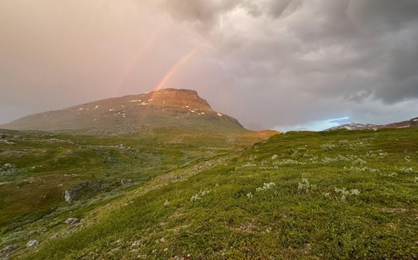
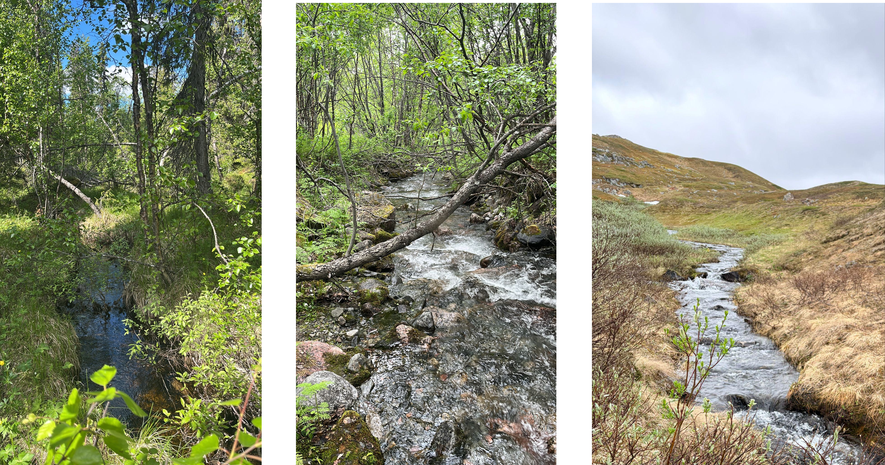

## Climate Change Impacts on Arctic Streams

The Arctic is warming twice as fast as the rest of the planet, driving rapid environmental change across the region. While changes in arctic terrestrial ecosystems are well documented through satellite imagery, the impacts of climate change on Arctic river ecosystems remain less understood. Assessing these impacts requires in-situ sensors to capture changes in river ecosystem processes over time and identify the environmental factors driving these changes.

To investigate how Arctic rivers respond to a changing climate, we established monitoring sites across a climate gradient spanning boreal forest, birch forest, and tundra-dominated rivers. These distinct vegetation zones are expected to shift in distribution and composition as temperatures rise. By monitoring river ecosystem processes across this gradient, we aim to identify how vegetation and associated environmental conditions shape river functioning. This approach will help us understand how Arctic rivers may respond to ongoing environmental change and improve predictions of their future responses to a warming climate.

{fig-align="center"}

{fig-align="center"}

------------------------------------------------------------------------

### Case Study Contact

**Contact:**

Ryan Sponseller, Umeå University\
📧 ryan.sponseller\@umu.se

Keridwen Whitmore, Umeå University\
📧 keridwen.whitmore\@umu.se

{width="15%"} {width="20%"}
