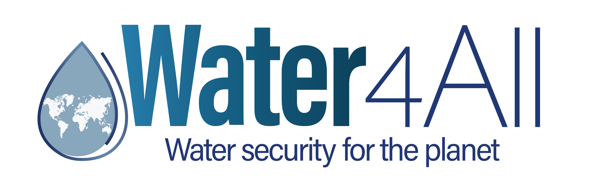
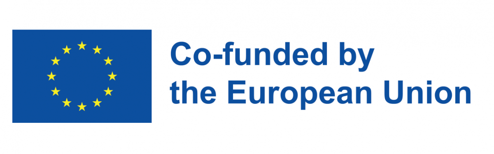
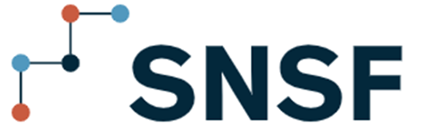
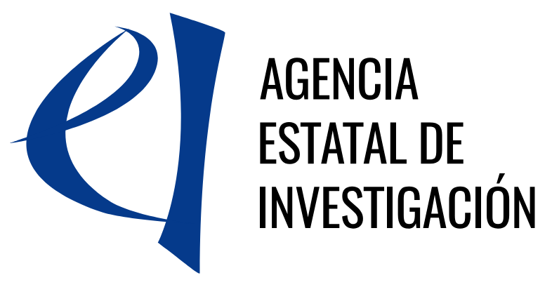
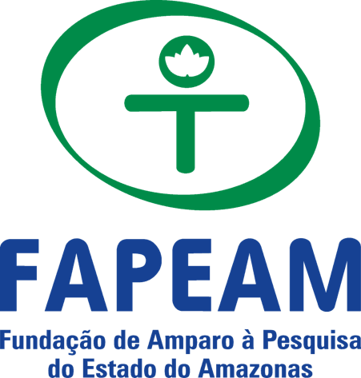

## About

BREATHE is a 3 year (2025-2028) Water4All project developing innovative, sensor-based approaches to monitor river health and ecosystem services. By using continuous dissolved oxygen measurements and river metabolism indicators, the project aims to provide a new generation of tools for assessing ecosystem functioning, supporting sustainable water management, and informing environmental policy.

## Background

Current indicators used in national river health assessment systems (e.g. EU Water Framework Directive) do not reflect well biodiversity, aquatic ecosystem functioning and services as needed for new and proposed policies. Progress in sensor technology over the last 20 years has allowed the continuous monitoring of dissolved oxygen and river metabolism (photosynthesis, respiration, metabolic balance) at unprecedented spatio-temporal scale and resolution.

BREATHE’s main objective is to co-design an international sensor-based River Observation System (RIOS) including dissolved oxygen and whole river metabolism to quantify aquatic ecosystem services such as climate regulation, water purification, provisioning fisheries for the implementation of European and global policies (EU 2030 Biodiversity Strategy, European Green Deal net zero greenhouse gas emissions by 2050, United Nations Sustainable Development Goals – notably Water and Sanitation for all.

BREATHE will reach this goal by engaging with stakeholders to: first, co-design a workflow from data collection to storage, integration and modelling, and second, co-construct case studies to demonstrate how the workflow may be applied at the local scale and integrated internationally.

The case studies are including key environmental issues in six countries:

- Forest restoration (Brazil)

- Water scarcity (Spain)

- Multiple stressors (Switzerland)

- Urban anoxia (United Kingdom)

- Water regulation (Norway)

- Climate change impacts (Sweden)

BREATHE will not only identify commonalities among regions, sharing solutions to barriers of implementation, but also focus on region-specific needs in aquatic ecosystem services and policies. Patterns, processes and experiences from low latitude might become future scenarios for higher latitudes.

BREATHE will provide guidance documents to optimise the development of monitoring networks, harmonise data collection and integration, and the modelling of the effect of drivers or remediation actions (restoration) on river ecosystem services.

## Funding and Acknowledgements

This project is funded through the European Union’s Horizon Europe Programme under the 2023 Joint Transnational Call of the European Partnership Water4All (Grant Agreement #101060874) and supported by national funding agencies in the participating countries including the Norwegian Research Council (RCN, 356999), Swedish Research Council for Environment, Agricultural Sciences and Spatial Planning (FORMAS, 2024-00996), Spanish Ministry of Science, Innovation and Universities and managed by the State Research Agency (PCI2025-163221), Engineering and Physical Sciences Research Council of UK Research and Innovation (EPSRC, UKRI EP/Z003474/1), Swiss National Science Foundation (SNSF, 223985), Fundação de Amparo à Pesquisa do Estado de Minas Gerais – (FAPEMIG, APQ-06893-24).

::: logo-grid
{alt="Water4All" width="40%"} {alt="European Union" width="45%"} {alt="Research Council of Norway" width="45%"} {alt="FORMAS" width="45%"} {alt="Swiss National Science Foundation" width="45%"} {alt="UK Research and Innovation" width="45%"} {alt="Agencia Estatal de Investigación" width="50%"} {alt="FAPEAM" width="40%"}
:::
